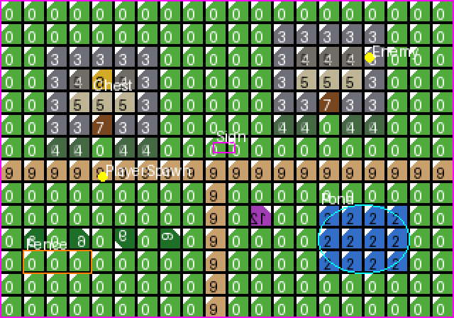

# tiled-web

**在浏览器里编辑 [Tiled](https://www.mapeditor.org/) 地图**：一个兼容 Tiled 1.2.4 地图格式的网页版编辑器，另外提供零依赖的 Node 命令行工具（CLI）和 MCP 服务器，方便脚本和 AI 助手批量处理地图。

[English](#english) · [AGPL-3.0](LICENSE)

> 本项目是独立的非官方实现，与 mapeditor.org 及官方 Tiled 无关。"Tiled" 名称归其作者所有。



*上图是 [`examples/full-demo`](examples/full-demo/) 用 CLI 生成的示例地图。*

## 功能

- **读写地图**：TMJ（JSON）/ TMX（XML）/ CSV；Base64 + zlib/gzip 压缩；内嵌与外部（`.tsx`）图块集；无限地图
- **编辑**：瓦片笔刷、填充、印章及翻转/旋转、对象（矩形/椭圆/点/多边形/图块对象）、图层与图层组、撤销/重做
- **地形与 Wang 集**：地形笔刷、概率、翻转变体
- **自动地图（AutoMap）**：规则地图、实时自动地图、规则可视化编辑
- **属性**：自定义属性、枚举/类（`propertytypes`）、碰撞编辑
- **World 与模板**：`.world` 多地图、对象模板（`.tx` / `.tj`）
- **多种朝向**：正交、等距、六边形、交错
- **打开文件夹**：按相对路径自动找到地图引用的图块集、图片和模板
- **中文界面与内置帮助**

## 打开网页版

不需要编译。网页版是纯静态文件，需要本机有 Python 3 来起一个本地服务：

```bash
git clone https://github.com/yujizhuu/tiled-web.git
cd tiled-web
./start.sh          # 默认端口 8806，可用 PORT=9000 ./start.sh 修改
```

然后用浏览器打开 <http://127.0.0.1:8806/>。macOS 也可以双击 `启动.command`。

### 打开文件夹，自动关联图块集

地图文件只记录图块集的相对路径（例如 `"source": "../village.tsx"`）。出于安全限制，网页不能自己按路径读硬盘，所以需要授权一个文件夹：

1. 点顶栏「打开文件夹」，选择包含地图**和**它引用的文件的那一层目录。
2. 浏览器询问权限时点「允许」。
3. 在列表中点要打开的地图，图块集、图片、模板和 `.world` 会按相对路径自动载入。
4. 按 Ctrl/⌘ + S 直接保存回原文件。

也可以把文件夹直接拖到画布上。「最近 ▾」会记住授权过的文件夹，下次重新确认一下权限即可。

### 内置帮助

点顶栏的蓝色 **?** 按钮（或按 F1 / ? 键）打开中文帮助。每一节按"是什么、为什么、怎么做"讲解并附例子，支持搜索。面板标题和工具组旁边的小 ? 会直接跳到对应章节。

### 浏览器支持

| 浏览器 | 编辑 | 打开文件夹 | 保存回原文件 / 记住最近文件夹 |
|---|---|---|---|
| Chrome / Edge / Opera | ✅ | ✅ | ✅ |
| Safari / Firefox | ✅ | ✅（只读） | ❌，保存时下载新文件 |

## 命令行工具（CLI）

需要 Node.js 18 或更高版本，没有任何 npm 依赖。

```bash
node cli/bin/tiled-web.js version
node cli/bin/tiled-web.js --help

# 可选：安装为全局命令 tiled-web
cd cli && npm link
```

示例：

```bash
CLI="node cli/bin/tiled-web.js"
$CLI new --width 32 --height 24 --tilewidth 16 --tileheight 16 -o /tmp/level.tmj
$CLI tileset add /tmp/level.tmj --name terrain --firstgid 1 --image terrain.png \
     --tilewidth 16 --tileheight 16 --columns 8 --tilecount 64
$CLI layer add /tmp/level.tmj --name Ground
$CLI fill /tmp/level.tmj --layer Ground --x 0 --y 0 --width 32 --height 24 --gid 1
$CLI set-tile /tmp/level.tmj --layer Ground --x 4 --y 5 --gid 3 --flip-h
$CLI object add /tmp/level.tmj --layer Objects --create-layer --name Spawn --type Player \
     --x 64 --y 48 --width 16 --height 16
$CLI prop set /tmp/level.tmj --target object --layer Objects --id 1 --name hp --value 100 --type int
$CLI info /tmp/level.tmj --format text
$CLI export /tmp/level.tmj -f tmx --encoding base64 --compression zlib -o /tmp/level.tmx
```

主要命令：

| 命令 | 作用 |
|---|---|
| `new` / `info` / `export` | 新建地图、查看信息、导出 TMJ/TMX/CSV |
| `set-tile` / `fill` / `get-layer` / `replace-gid` | 写入、填充、读取、批量替换瓦片 |
| `layer` / `tileset` / `object` | 管理图层、图块集、对象 |
| `prop` / `prop types` | 自定义属性与枚举/类类型（也支持 `.tiled-project`） |
| `stamp copy\|paste` | 复制、粘贴区域印章 |
| `template info\|index\|apply` | 查看、索引、放置对象模板 |
| `automap` | 按规则自动绘制（可用 `--radius` 限定范围） |
| `world` | 管理 `.world` 文件 |
| `coord` | 像素与瓦片坐标互换（四种朝向） |
| `wang list` / `terrain list` | 列出 Wang 集和地形 |

成功结果输出到 stdout（多为 JSON），错误输出到 stderr 并返回非零退出码。写操作默认原地保存，加 `-o` 另存。完整参数见 `--help`。

## MCP 服务器

`cli/mcp-server.js` 是一个 stdio MCP 服务器，把 CLI 能力提供给支持 MCP 的 AI 客户端（Cursor、Claude Desktop 等）。在客户端配置中加入：

```json
{
  "mcpServers": {
    "tiled-web": {
      "command": "node",
      "args": ["/path/to/tiled-web/cli/mcp-server.js"]
    }
  }
}
```

提供的工具：`tiled_version`、`tiled_info`、`tiled_new`、`tiled_set_tile`、`tiled_fill`、`tiled_get_layer`、`tiled_layer`、`tiled_object`、`tiled_prop`、`tiled_stamp`、`tiled_template`、`tiled_automap`、`tiled_world`、`tiled_replace_gid`、`tiled_export`、`tiled_coord`、`tiled_wang`、`tiled_terrain`。

## 示例

[`examples/full-demo/`](examples/full-demo/) 用一个脚本从零做出一张村庄地图和一张无限洞穴地图，用到了 CLI 的全部命令和 MCP 服务器，并用官方 Tiled 校验结果：

```bash
cd examples/full-demo
bash build.sh      # 生成 out/ 下的全部文件
```

## 格式兼容性

- 以 Tiled 1.2.4 的 TMJ/TMX 格式为准，属性使用 1.2+ 的数组格式，旧格式也能读。
- 示例生成的文件可以被官方 Tiled 1.11 正常打开，渲染结果逐像素一致。
- 不支持 zstd 压缩（属于更新版本的格式）。

## 已知限制

- 不支持 Tiled 桌面版的插件和脚本（JavaScript 扩展）。
- 网页版暂不能新建图像层，也不能编辑图块动画帧。
- 网页无法监视文件变化；读取引用文件需要先授权文件夹。
- 很大的 Wang 集或 World 同时绘制时可能变慢。
- CLI 是批处理工具，没有实时自动地图、笔刷交互和撤销历史，这些在网页版里使用。

## 开发与测试

```bash
cd tool && python3 test_smoke.py
cd cli && ./test_smoke.sh
```

`tool/` 是网页版（静态站点根目录），`cli/` 是命令行工具和 MCP 服务器，`examples/` 是示例。

## 许可证与致谢

- 代码以 [GNU AGPL-3.0](LICENSE) 发布。
- `tool/pako.min.js` 来自 [pako](https://github.com/nodeca/pako)（MIT / Zlib），详见 [NOTICE](NOTICE)。
- 感谢 [mapeditor/tiled](https://github.com/mapeditor/tiled) 及其作者 Thorbjørn Lindeijer 和贡献者，本项目的格式与行为均参照 Tiled。官方桌面版请到 [mapeditor.org](https://www.mapeditor.org/) 下载。

---

## English

**tiled-web** is an unofficial, browser-based map editor compatible with the [Tiled](https://www.mapeditor.org/) 1.2.4 map formats. It also ships a zero-dependency Node.js CLI and an MCP server, so scripts and AI agents can edit maps too. The UI is in Chinese.

### Features

- Read/write TMJ, TMX and CSV; Base64 with zlib/gzip; embedded and external (`.tsx`) tilesets; infinite maps
- Tile brushes, fill, stamps with flips/rotation, objects, layers and groups, undo/redo
- Terrain and Wang sets, AutoMap (including live automapping and a visual rule editor)
- Custom properties and property types, collision editing, worlds and object templates
- Orthogonal, isometric, hexagonal and staggered maps
- **Open folder**: tilesets, images and templates referenced by a map are resolved by relative path
- Built-in searchable help (the **?** button, or F1)

### Run the web editor

No build step. You need Python 3 for a local static server:

```bash
git clone https://github.com/yujizhuu/tiled-web.git
cd tiled-web && ./start.sh   # then open http://127.0.0.1:8806/
```

Use **打开文件夹 (Open folder)** and pick the directory that contains both the map and the files it references. Chrome, Edge and Opera can save back in place and remember recent folders. Safari and Firefox are read-only for folders and save by downloading.

### CLI

Node.js 18+, no dependencies:

```bash
node cli/bin/tiled-web.js --help
node cli/bin/tiled-web.js new --width 20 --height 15 -o /tmp/map.tmj
node cli/bin/tiled-web.js fill /tmp/map.tmj --x 0 --y 0 --width 20 --height 15 --gid 1
node cli/bin/tiled-web.js export /tmp/map.tmj -f tmx -o /tmp/map.tmx
```

### MCP

Add `{"command": "node", "args": ["/path/to/tiled-web/cli/mcp-server.js"]}` under `mcpServers` in your MCP client config. It exposes 18 tools that mirror the CLI.

### Example, compatibility and limitations

- `examples/full-demo/build.sh` builds a sample village and an infinite cave map using every CLI command. Its output opens in official Tiled 1.11 and renders pixel-identically.
- Not supported: desktop plugins and scripting, zstd compression, creating image layers or editing tile animations in the web UI.

### License

AGPL-3.0. Thanks to [mapeditor/tiled](https://github.com/mapeditor/tiled) by Thorbjørn Lindeijer and contributors. This project is not affiliated with them.
